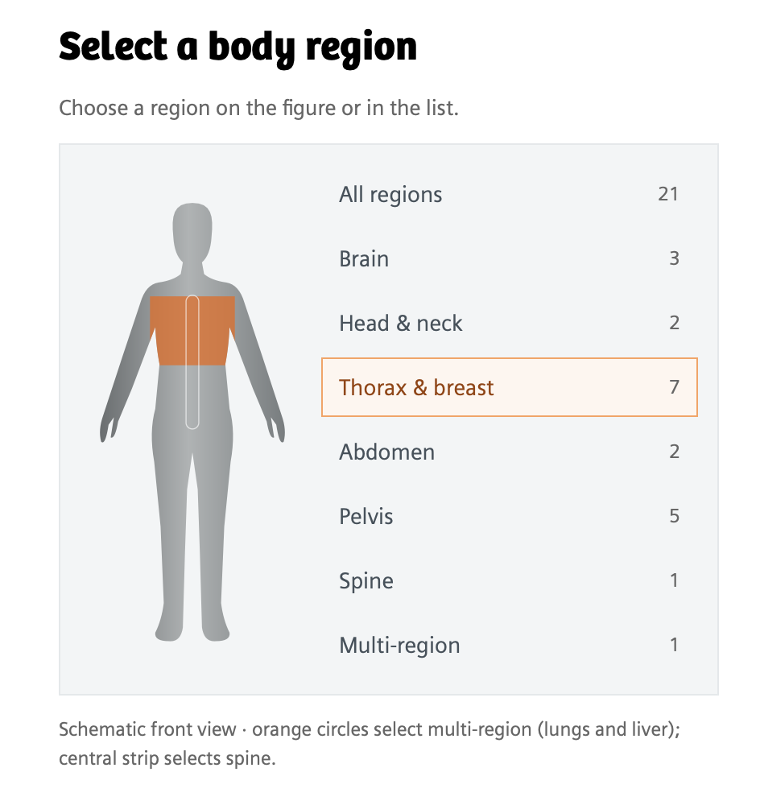
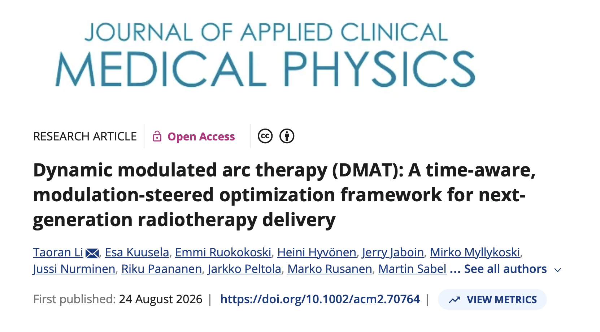

# NeoArc (DMAT) Case Library

**510(k) pending. Not available for sale in any market and no guarantee of commercialization or feature availability.**

**[Explore the NeoArc (DMAT) Case Library →](https://varian-medicalaffairsappliedsolutions.github.io/dmat-case-library/index.html)**

  

This repository stores the webpages and supporting assets in [`docs/`](docs/) for publication through **GitHub Pages (`github.io`)** as the NeoArc (DMAT) Case Library. The website is an interactive educational showcase of **NeoArc (DMAT), or Dynamic Modulated Arc Therapy** capabilities and the **time–quality navigation** concept across different anatomical sites and planning scenarios. The reports bring together dose distributions, dose–volume histograms (DVHs), selected dosimetric endpoints, and delivery-time information to make planning trade-offs easier to explore.

**For education and demonstration only. Not intended for clinical use or clinical decision-making.**

## Scientific reference

[Dynamic modulated arc therapy (DMAT): A time-aware, modulation-steered optimization framework for next-generation radiotherapy delivery](https://aapm.onlinelibrary.wiley.com/doi/abs/10.1002/acm2.70764). *Journal of Applied Clinical Medical Physics*. 2026;27(9):e70764. DOI: [10.1002/acm2.70764](https://doi.org/10.1002/acm2.70764).

## Exploring time–quality navigation

On the [published website](https://varian-medicalaffairsappliedsolutions.github.io/dmat-case-library/index.html), start with the case library index and select an anatomical site. Within a report:

1. Review the case overview, prescription, planning setup, and reference plans.
2. Compare synchronized dose-colorwash slices across the available modulation levels.
3. Explore quality–time plots and individual endpoints to see how the displayed dosimetric measures vary with delivery time.
4. Toggle plans and structures in the DVH comparison to inspect coverage and organ-at-risk dose.
5. Where available, use **Plan in motion** to view an illustrative delivery animation.

## Disclaimers and limitations

For education and demonstration only. Not intended for clinical use or clinical decision-making.

This library showcases the technical capabilities of the NeoArc (DMAT) algorithm. It makes no claim of clinical value, clinical benefit, or improved patient outcomes. Some results shown were generated using non-clinical algorithm versions.

Products or features shown may not be commercially available. Availability varies by country, and future availability or commercialization is not guaranteed.

Results reflect the specific planning data, configurations, and evaluation methods shown; results in other settings may differ. These examples do not establish clinical safety, effectiveness, or superiority.

**510(k) pending. Not available for sale in any market and no guarantee of commercialization or feature availability.**

For demonstration only. Does not reflect actual machine specifications, dimensions, or delivered treatment.

Illustrative only. The machine visualization is based on publicly available data and does not represent actual machine specifications or dimensions.

Viewer capabilities depend on the case package. Some lightweight viewers omit dose grids and accumulation caches and disable accumulation. Playback-only viewers may preserve prepared dose contributions while omitting the source dose grid and illustrative exposure cache. All dose animation is illustrative and unsuitable for dose measurement or clinical decision-making.

## Third-party components

The delivery viewers include third-party components with their own copyright notices and license terms. See the `THIRD-PARTY-NOTICES.txt` and `licenses/` files within each `delivery-viewer` directory under `docs/`. Those notices and terms remain applicable.

## Analytics consent

The reporting purpose is to count page visits, show when visits happen, and report
approximate visitor country/region/city. GA4 derives location from the visitor's
internet connection; the site does not request browser geolocation. City availability
depends on GA4's regional location settings and reporting thresholds. GA4 also
collects standard device/session metadata, as described in the consent notice.
For minimal measurement, turn off optional Enhanced measurement events in the
GA4 web stream (scrolls, outbound clicks, search, video, downloads, and forms),
and set the property's reporting time zone. These are Analytics account settings.

All pages use `docs/assets/analytics-consent.js` and its stylesheet. Google Analytics
(`G-82757TJGTE`) loads only after explicit acceptance or a valid saved acceptance.
Accept and Reject have equal prominence. Cookie settings allows withdrawal, which
disables Analytics, clears this implementation's cookies, and reloads the page to
unload Google's listeners. Embedded viewers do not load Analytics; standalone
viewers use the same consent controls. Choices are scoped to this site's base path
and remembered for 180 days. Missing, invalid, expired, or inaccessible stored
choices default to Analytics off. No Google consent pings are sent before acceptance.

Advertising consent stays denied, Google signals are disabled, and the configured
page location omits query strings and fragments. Cookies use a site-specific prefix,
host-only domain, site base path, and 180-day maximum age without renewal.

The consent details link to the Cancer Care privacy notice used by the referring
Medical Affairs practitioner-aids page and its published privacy contact. Consent
is collected independently here: a referral from siemens-healthineers.com does not
transfer its consent cookies or local storage to github.io. Reusing the corporate
consent choice requires an approved cross-domain integration configured by the
corporate consent platform owner; a referring URL is not proof of consent. Although
the public privacy notice links to TrustArc, the current Medical Affairs page source
loads Usercentrics; the web team should provide the configuration approved for this
site rather than copying the notice's consent-center link as an integration.

Before publishing, confirm that the corporate notice covers this site and its
Analytics use, confirm the Google Analytics processing/transfer arrangements
and property retention settings, and review enhanced measurement settings (especially
form interactions, site search, and outbound URLs) for unintended data collection.
The banner is a technical consent control, not a complete GDPR compliance assessment.
GitHub's hosting data processing is separate from optional Google Analytics.

Run `node --test tests/analytics-consent.test.cjs` for consent lifecycle checks.
After deployment, verify in browser Network tools that no Google requests occur
before acceptance or after rejection, and verify accepted visits in GA Realtime.
